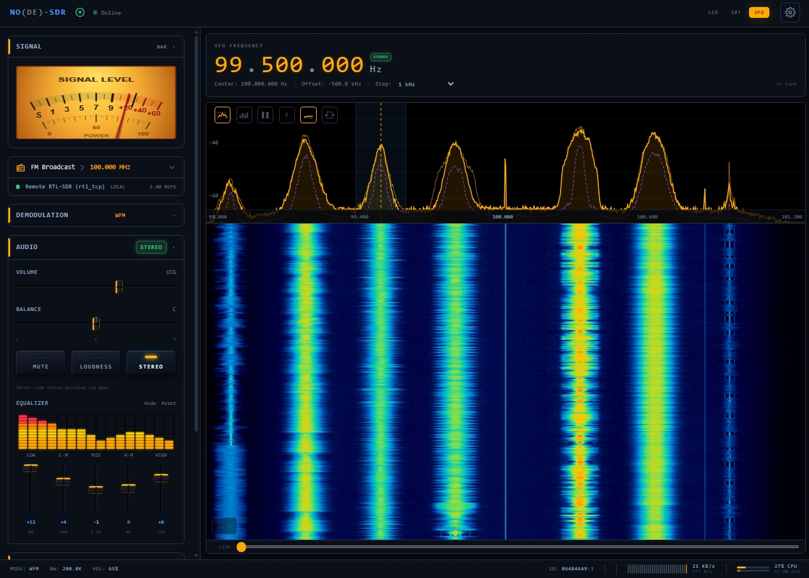

<p align="center">
  
</p>

<h1 align="center">no-sdr</h1>

<p align="center">
  <strong>A multi-user WebSDR with native SDR drivers, a live spectrum and waterfall,
  server-side digital decoding, an operations map, and an analytics/admin console — all
  from one Rust backend.</strong>
</p>

<p align="center">
  <strong>**** Next Major Release 3.0.0 will add Vulkan support for CPU offloading ****</strong>
</p>

<p align="center">
  <a href="https://github.com/gbozo/no-sdr/stargazers"></a>
  &nbsp;
  <a href="https://github.com/gbozo/no-sdr/network/members"></a>
  &nbsp;
  <a href="https://github.com/gbozo/no-sdr/watchers"></a>
</p>

<p align="center">
  <a href="https://github.com/gbozo/no-sdr/actions"></a>
  <a href="https://github.com/gbozo/no-sdr/releases"></a>
  
  
  <a href="https://github.com/gbozo/no-sdr/blob/main/LICENSE"></a>
  
  <a href="https://github.com/gbozo/no-sdr/issues"></a>
  <a href="https://github.com/gbozo/no-sdr/pulls"></a>
  
  
</p>

<p align="center">
  <a href="#quick-start">Quick Start</a> &bull;
  <a href="#features">Features</a> &bull;
  <a href="#native-decoder-suite">Decoders</a> &bull;
  <a href="#live-operations-map">Map</a> &bull;
  <a href="#configuration">Configuration</a> &bull;
  <a href="#deployment">Deployment</a> &bull;
  <a href="SPEC.md">Technical Spec</a>
</p>

<p align="center">
  <sub>If you find this project useful, please consider giving it a <a href="https://github.com/gbozo/no-sdr">star on GitHub</a> — it helps others discover it and keeps the motivation flowing! :star:</sub>
</p>

---

<p align="center">
  
</p>

**no-sdr** turns cheap SDR hardware into a complete browser-based radio station.
Multiple users connect at once and independently tune, demodulate and listen inside
the dongle's live bandwidth. There are no browser plugins and no client install:
open a URL and the receiver is there.

It is built as an open alternative to closed WebSDR services, with a strong focus on
weak-signal performance, low bandwidth, ARM compatibility and native decoding — the
decoders are part of the Rust server, not a pile of external binaries.

*Made with ❤️ and patience, your friend George*

## At a glance

| Area | What you get |
|------|--------------|
| **SDR sources** | RTL-SDR, HackRF, Airspy R2/Mini, Airspy HF+, HydraSDR, ELAD, RX-888, PlutoSDR, SDRplay, LimeSDR, Fobos, `rtl_tcp`/`airspy_tcp`/`hfp_tcp`/`rsp_tcp`, demo simulator |
| **Analog modes** | WFM stereo + RDS, NFM, AM, C-QUAM AM stereo, SAM, USB, LSB, CW, Raw IQ |
| **Digital decoders** | 31 native decoders: weak-signal, aircraft, marine, APRS/packet, image/text and time signals |
| **Map** | Live ADS-B, AIS, APRS/HFDL and FT8/FT4/FT2/WSPR grid spots; station marker; airports/navaids; Maidenhead grid; OpenSeaMap seamarks; weather; trails |
| **Admin** | Dongle/profile management, device scanning, bookmarks, decoder workers, feature flags, monitoring, music ID |
| **Analytics** | User sessions, live/history maps, country/region stats, top modes/frequencies, retention and purge |
| **Compression** | Per-client FFT codecs and IQ codecs, including server-side Opus and stereo FM |
| **Platforms** | Linux, Docker, Raspberry Pi ARM64, Windows/macOS/Linux desktop builds |

## Features

### Receiver and DSP

- **Multi-user operation** — everyone sees the same waterfall; every client tunes independently inside the active profile.
- **Shared FFT, per-client IQ** — one FFT per dongle is broadcast to all clients, while each client gets its own NCO-shifted, filtered and decimated IQ stream.
- **9 analog modes** — WFM (stereo + RDS), NFM, AM, AM stereo (C-QUAM), SAM, USB, LSB, CW and Raw IQ.
- **Stereo FM** — 19 kHz pilot PLL, L−R DSB-SC demodulation, SNR-proportional stereo blend and RDS (PS/RT/PTY/PI/clock).
- **C-QUAM AM stereo** — automatic pilot detection and PLL confirmation; experimental and always looking for field reports.
- **Synchronous AM** — carrier PLL for fading or weak AM signals.
- **Fast tuning** — spectrum/waterfall click-to-tune, fine-tune drag, scroll tuning, zoom, pan and range selection.
- **USB/LSB sideband-aware tuning indicator** — dial at the passband edge, bandwidth extending left or right.
- **Waterfall history and rewind** — scroll back through recent spectrum history.
- **Signal analysis** — secondary FFT, signal level/SNR analysis and a client-side signal identifier that ranks likely decoder modes.
- **Music identification** — identify the currently tuned song with AudD or ACRCloud from the admin-configured provider.

### Native SDR drivers

| Driver family | Sources |
|---------------|---------|
| Native USB | RTL-SDR (RTL2832U/R82xx), HackRF One/Pro, Airspy R2/Mini, Airspy HF+, HydraSDR RFOne, ELAD FDM, RX-888 Mk2, PlutoSDR |
| Vendor libraries | SDRplay RSP, LimeSDR, Fobos SDR (loaded at runtime with `dlopen`; no SDK required to build) |
| Network | `rtl_tcp`, `airspy_tcp`, `hfp_tcp`, `rsp_tcp` |
| Simulator | Built-in demo signal generator; no hardware required |

Native USB drivers use `nusb` — no librtlsdr, libusb, libhackrf, libairspy, libhydrasdr or libiio dependency. Hardware options include direct sampling, bias-T, digital AGC, offset tuning, IQ correction, PPM correction, gain stages and per-source settings exposed in the admin UI.

### Native decoder suite

All 31 decoders below are implemented in Rust and run inside the server. No `jt9`, `wsprd`, `dump1090`, `dumpvdl2` or other external decoder process is required.

| Category | Decoders |
|----------|----------|
| **Weak signal / HF** | FT8, FT4, FT2, FST4, Q65, JT65, JT9, JS8, WSPR, PI4, MSK144, FSK441 |
| **Aircraft** | ADS-B (1090 MHz), ACARS, VDL2, HFDL |
| **Marine** | AIS, NAVTEX |
| **Terrestrial / utility** | APRS, AX.25 packet, ISM |
| **Image / text** | WEFAX, SSTV, Hellschreiber, Olivia, THOR, FSQ, PSK31, RTTY |
| **Time signals** | DCF77, ALS162 |

Each decoder supports:

- **Foreground operation** for the tuned client (FT8-family, vocal/data modes and raw-IQ modes)
- **Background operation** per dongle, independent of what the current listener is doing
- **Persistent history** in SQLite with retention, message search and statistics
- **Live decoder workspace** with slots, SNR/DT/confidence, FEC information, secondary waterfall and mode-specific details
- **Decoder calling-frequency catalogue** — server-owned and periodically refreshed, used by hints, quick-tune links and the bookmark ribbon
- **Signal-aware tuning overlays** showing the exact decoder passband and dial position
- **Map spotting** for grid-bearing modes and position reports

### Live operations map

The full-screen `/map` page uses OpenStreetMap and a separate WebSocket (`/ws/map`), so map traffic never competes with audio or FFT traffic.

Layers include:

- **Aircraft** — ADS-B positions, callsigns, altitude, speed, track, vertical rate, squawk, emergency state, last seen.
- **Vessels** — AIS positions, MMSI, type, callsign, speed/course/heading, destination, ETA.
- **Grid decodes** — FT8/FT4/FT2/WSPR and other grid-bearing modes plotted at their Maidenhead grid centre.
- **Position reports** — APRS and HFDL latitude/longitude fixes.
- **Airports** — OurAirports public-domain airport data, filtered by viewport and zoom.
- **Navaids** — VOR, VORTAC, TACAN, NDB and DME stations from OurAirports.
- **Maidenhead grid** — field, 4-character square and 6-character subsquare overlay.
- **OpenSeaMap** — seamarks, buoys, lights, and nautical symbols.
- **Cloud cover** — OpenWeatherMap tiles fetched directly by the browser.
- Airport and navaid reference data courtesy of [OurAirports](https://ourairports.com/) (public domain). Airport and navaid ranges are admin-configurable in km from the receiver location; `0` disables the limit.
- Aircraft/vessel trails are simplified server-side and stored with the entity: 5% line tolerance, 500 ft altitude tolerance, up to 240 significant points.

Map details:

- Station marker with receiver callsign, grid, location, client count and decoder capabilities.
- Blue → cyan → green trails through all stored positions, with black position dots.
- Neon-green dashed predicted trajectory using speed and heading.
- Altitude-dependent aircraft shadows; white cel-shaded aircraft/vessel icons.
- Live/dead reckoning between reports, stale-target greying after one minute, removal after five minutes.
- Popups with altitude/speed histograms, last-seen data, and external links to Flightradar24, ADS-B Exchange, MarineTraffic and VesselFinder.
- Map styles: dark, OSM, light, satellite and terrain.
- Layer selection and map style persist in the browser.

### Admin console

The `/admin` interface covers:

- **General** — station identity, callsign/location/coordinates, codec allow-lists, server behaviour and configuration persistence.
- **SDR Devices** — add/edit dongles, scan for attached hardware, save the selected device index/serial, start/stop dongles, switch active profiles, CRUD profiles and tune hardware settings.
- **Bookmarks** — region/country folder selection, band-plan region, read-only decoder calling-frequency catalogue, and admin bookmark CRUD.
- **Decoders** — create/edit/delete background decoder workers, set frequencies/bandwidths/dongle assignments, inspect decoder stats/history and purge data.
- **Monitor** — server health, connected clients, decoder activity, database statistics, user sessions and analytics maps.
- **Music ID** — AudD/ACRCloud provider configuration.
- **Features** — runtime feature switches.
- **Cloudflare Edge** — optional edge transport settings.

### Presence and analytics

Every WebSocket connection is recorded in the shared SQLite database.

- Live OpenStreetMap of current listeners and recently disconnected users.
- Country/region/city, receiver/profile, tuned frequency, demod mode and bandwidth.
- Historical map with region bubbles sized by user count.
- Session counts, peak concurrency, country/region rankings, top modes and top frequencies.
- Configurable retention and purge intervals.
- Offline IP geolocation via DB-IP City Lite, updated automatically; public ribbon exposes only country/region, while city/coordinates remain admin-only.
- Admin APIs for maps, analytics, purge, and geolocation status/update.

### Bookmarks and band plans

- User bookmarks with one-click recall, mode/bandwidth restoration and optional decoder activation.
- Admin bookmarks from `config.yaml` and regional bookmark folders.
- Multi-select bookmark regions with a `global` root group.
- Configurable ITU region band plan (`r1`, `r2`, `r3`) plus worldwide.
- Generated, read-only decoder calling frequencies exposed as `source: "decoder"` bookmarks and shown on the spectrum ribbon.

### Compression and networking

| Stream | Codecs |
|--------|--------|
| **FFT / waterfall** | Range, deflate (lossless), ADPCM, or uncompressed |
| **IQ / audio** | Opus HQ, Opus, Opus Lo, ADPCM, or uncompressed |

- Per-client codec negotiation; no restart needed when switching.
- Server-side Opus path with server-side demodulation for WFM stereo/C-QUAM.
- FFT rate caps and inter-frame averaging per profile.
- IQ chunk accumulation (fixed 20 ms chunks) for consistent WebSocket traffic.
- Backpressure handling, audio-gated IQ and client-side resampling.
- Live compression statistics: wire bytes, raw equivalent, ratio and savings.

A typical 2.4 MSPS HF profile with deflate FFT and Opus mono audio uses roughly 12–15 KB/s per client for waterfall, spectrum and audio together.

### Desktop and packaging

- Electron desktop builds for Windows, macOS and Linux, bundling the Rust server and web client.
- Portable Linux/Windows/macOS archives from GitHub Actions.
- Multi-arch Docker images (amd64/arm64), with CPU-feature variants on x86.
- Raspberry Pi 4/5 ARM64 support.

## Quick Start

### Prerequisites

- **Rust 1.85+**
- **Node.js 26+**
- An SDR dongle, a remote `rtl_tcp` source, or demo mode
- Optional vendor libraries for SDRplay, LimeSDR and Fobos SDR

### Install and run

```bash
git clone https://github.com/gbozo/no-sdr.git
cd no-sdr
npm install
npm run build
npm start
```

Open `http://localhost:3000`.

### Demo mode

No hardware? Use the simulator:

```bash
npm run dev:demo
```

The waterfall, spectrum, tuning and demodulation all work exactly as with real hardware.

### Desktop

Release downloads include Electron packages. To build locally:

```bash
npm run build:client
cd serverrs && cargo build --release --all-features --bin serverrs && cd ..
npm run dist:linux --workspace=desktop   # or dist:mac / dist:win
```

See [`desktop/README.md`](desktop/README.md).

## Architecture

```text
SDR source (native USB / vendor library / TCP / demo)
  │
  ▼
Rust server
  ├─ FFT processor (one per dongle) ──► shared WebSocket FFT frames
  ├─ Background decoders (per dongle) ─► SQLite history + decoder broadcasts
  ├─ Per-client IQ extractor (NCO + Butterworth + decimation)
  │    ├─ ADPCM/raw IQ ──► WebSocket ──► browser demodulator
  │    └─ server-side demod + Opus ──► WebSocket ──► browser audio
  ├─ User sessions / analytics ──► SQLite ──► admin monitor
  └─ Map feed (checkpoint + /ws/map) ──► map page
```

The browser owns the main analog demodulation path unless Opus is selected. It also owns the waterfall/spectrum renderers, RDS, audio worklet, equaliser, noise reduction, decoder workspace and map UI.

## Configuration

Configuration is YAML (`config/config.yaml`), validated at startup and persisted when changed through the admin UI.

```yaml
server:
  host: "0.0.0.0"
  port: 3000
  adminPassword: "change-me"
  callsign: "MYCALL"
  location: "Athens, Greece"
  receiverLatitude: 37.98
  receiverLongitude: 23.72
  bookmarkRegions: [global, r1]
  bandplanRegion: r1
  decoderBookmarksEnabled: true
  decoderCatalogUrl: "https://raw.githubusercontent.com/gbozo/no-sdr/main/serverrs/decoder-catalog.json"

dongles:
  - id: dongle-0
    name: "RTL-SDR #0"
    enabled: true
    autoStart: true
    source:
      type: local
      deviceIndex: 0
      serial: ""
    sampleRate: 2400000
    gain: 0.0
    ppmCorrection: 0
    directSampling: 0
    biasT: false
    iqCorrection: true
    profiles:
      - id: fm-broadcast
        name: "FM Broadcast"
        centerFrequency: 100000000
        sampleRate: 2400000
        defaultMode: wfm
        defaultBandwidth: 200000
        fftSize: 32768
        fftFps: 24
        gain: 12.0
        tuningStep: 1000
        description: "FM broadcast with stereo and RDS"

decoders:
  - id: ft8-20m
    enabled: true
    dongleId: dongle-0
    mode: ft8
    frequencyHz: 14074000
    bandwidthHz: 3000
```

### Source types

| Type | Description | Config |
|------|-------------|--------|
| `local` | Native USB RTL-SDR | `deviceIndex` / `serial` |
| `hackrf`, `airspy`, `airspyhf`, `hydrasdr`, `elad`, `rx888` | Native USB drivers | `serial` + source `settings` |
| `pluto` | PlutoSDR over IIOD | `host`, `port` |
| `sdrplay`, `lime`, `fobos` | Vendor-library drivers loaded at runtime | serial/device string + `settings` |
| `rtl_tcp`, `airspy_tcp`, `hfp_tcp`, `rsp_tcp` | Remote TCP sources | `host`, `port` |
| `demo` | Built-in simulator | none |

### Profiles

Each dongle has one or more profiles. Switching the active profile updates every connected client on that dongle: centre frequency, sample rate, mode, bandwidth and FFT settings. Profiles can be created, updated and deleted from the admin UI or the REST API.

### Optional integrations

- **OpenWeatherMap** — set `server.openWeatherMapApiKey` to enable the map cloud-cover layer. Browsers fetch tiles directly from OpenWeatherMap; the key is public and cloud image traffic does not pass through the server.
- **AudD / ACRCloud** — set the provider credentials to enable the Music ID button.
- **DB-IP City Lite** — optional offline geolocation for user analytics.

### Environment variables

| Variable | Default | Description |
|----------|---------|-------------|
| `CONFIG_PATH` | `../config/config.yaml` | Config file path |
| `STATIC_DIR` | `../client/dist` | Built client assets |
| `BOOKMARKS_DIR` | `../bookmarks` | Bookmark JSON directory |
| `HOST` | config `server.host` | Bind host override |
| `PORT` | config `server.port` | Bind port override |
| `NODE_SDR_DEMO` | — | `1` forces demo mode |
| `LOG_LEVEL` | config `server.logLevel` | Log level override |

### Offline IP geolocation

Connected listeners can be mapped to country/region without sending addresses to a third party:

```yaml
geoip:
  enabled: true
  databasePath: ../data/dbip-city-lite.mmdb
  autoUpdate: true
  updateIntervalHours: 24
```

DB-IP City Lite updates monthly, is hot-swapped without dropping lookups, and stays inside the server process. Public ribbons show country/region only; admin monitor data includes city/coordinates. Admin APIs: `GET /api/admin/geoip`, `POST /api/admin/geoip/update`.

## API

### Public

| Method | Endpoint | Description |
|--------|----------|-------------|
| `GET` | `/api/status` | Status, uptime, client count |
| `GET` | `/api/dongles` | Configured dongles and runtime state |
| `GET` | `/api/dongles/:id/profiles` | Profiles for a dongle |
| `GET` | `/api/bandplan` | Band plan (region-aware) |
| `GET` | `/api/bookmarks` | Admin/user/decoder bookmark feed |
| `GET` | `/api/decoder/history` | Persisted decoder messages with filters |
| `GET` | `/api/decoder/messages` | Message feed |
| `GET` | `/api/decoder/summary` | Decoder statistics summary |
| `GET` | `/api/decoder/aircraft` | Persisted ADS-B entities |
| `GET` | `/api/decoder/vessels` | Persisted AIS entities |
| `GET` | `/api/decoder/modes` | Supported background decoder modes |
| `GET` | `/api/decoder/catalog` | Read-only decoder calling-frequency catalogue |
| `GET` | `/api/map/checkpoint` | Initial map snapshot |
| `GET` | `/api/map/aviation` | Viewport airports or navaids from OurAirports |

### Admin

Admin endpoints use the admin session cookie, or `Authorization: Bearer <password>`.

| Method | Endpoint | Description |
|--------|----------|-------------|
| `POST` | `/api/admin/login` | Authenticate |
| `POST` | `/api/admin/save-config` | Persist config |
| `POST` | `/api/admin/dongles/:id/start` / `stop` | Control a dongle |
| `POST` | `/api/admin/dongles/:id/profile` | Switch active profile |
| `POST`/`PUT`/`DELETE` | `/api/admin/dongles/:id/profiles[/:pid]` | Profile CRUD |
| `GET` | `/api/admin/bookmarks/regions` | Bookmark folder options and selection |
| `GET` | `/api/admin/decoder-catalog` | Decoder catalogue status/entries |
| `POST` | `/api/admin/decoder-catalog/refresh` | Force catalogue refresh |
| `GET`/`POST`/`PUT`/`DELETE` | `/api/admin/decoders[/:id]` | Background decoder CRUD |
| `GET` | `/api/admin/users/map` | Live user map |
| `GET` | `/api/admin/users/analytics` | Session analytics |
| `POST` | `/api/admin/users/purge` | Purge user history |
| `GET` | `/api/admin/geoip` | GeoIP status |
| `POST` | `/api/admin/geoip/update` | Update GeoIP database |
| `GET` | `/api/admin/status` | Detailed server status |

## WebSocket

| Socket | Format | Purpose |
|--------|--------|---------|
| `/ws` | Binary server → client; JSON client → server | Audio, IQ, FFT, metadata, decoders, user ribbon |
| `/ws/map` | JSON server → client | Map checkpoint plus incremental aircraft/vessel/position/grid updates |

The map socket is intentionally separate so a busy map never delays audio or waterfall frames. See [SPEC.md](SPEC.md) for the binary protocol.

## Deployment

### Docker Compose

```bash
cd docker
docker compose up -d
```

USB passthrough on Linux needs the device mounted (and often `privileged: true`):

```yaml
services:
  no-sdr:
    image: ghcr.io/gbozo/no-sdr:latest
    ports:
      - "3000:3000"
    environment:
      - LOG_LEVEL=info
    privileged: true
    devices:
      - /dev:/dev
    volumes:
      - ../config:/app/config
    restart: unless-stopped
```

For a remote dongle, set `source.type: rtl_tcp`, `host: rtl_tcp`, `port: 1234`.

### Raspberry Pi

Runs on ARM64 (tested on Pi 4/5):

```bash
git clone https://github.com/gbozo/no-sdr.git
cd no-sdr
npm install
npm run build
npm start
```

### Reverse proxy

Only needed for TLS termination:

```nginx
server {
    listen 80;
    server_name sdr.example.com;

    location / {
        proxy_pass http://127.0.0.1:3000;
        proxy_http_version 1.1;
        proxy_set_header Upgrade $http_upgrade;
        proxy_set_header Connection "upgrade";
        proxy_set_header Host $host;
    }
}
```

## Development

```bash
npm run dev          # Rust server :3000 + Vite :3001
npm run dev:demo     # Same, with simulated signals
npm run build        # client + Rust release build
npm run typecheck
npm run test:rust
```

### Project structure

```text
serverrs/               Rust backend
  src/api/              REST, admin, band plan, bookmarks, map feed
  src/ws/               Main WebSocket protocol and client manager
  src/dsp/              FFT, NCO, filters, decimation, IQ correction
  src/demod/            FM, AM, SSB, CW, SAM, C-QUAM
  src/decoders/         Native decoder workers and SQLite store
  src/dongle/           Sources, native drivers, Opus, recording
client/                 SolidJS client
  src/components/       Receiver UI, decoder workspace, waterfall, map
  src/engine/           Demodulators, RDS, audio, workers, analysis
  src/admin/            Admin console and analytics views
  src/shared/           Protocol, modes, types, grids, decoder catalogue
desktop/                Electron shell and packaging
docker/                 Container build and compose
```

Build order is client → Rust server, because the server serves the built SPA.

## Contributing

1. Fork and create a feature branch.
2. Run `npm run build && npm run typecheck` before submitting.
3. Keep pull requests focused — one feature or fix per PR.
4. Add config examples when introducing new modes, sources or decoders.

### Where help is useful

- **C-QUAM AM stereo field reports** — especially near C-QUAM stations.
- **New native decoders** and improvements to weak-signal performance.
- **GPU/Vulkan DSP** — FFT, FIR, NCO, decimation and FM stereo FIR are the first targets.
- **WebGL waterfall** for very large FFT sizes.
- **DSP and protocol tests**, especially on ARM hardware.
- **Documentation** for source drivers, decoder settings and deployment setups.

## License

GPL-3.0-or-later.

This program is free software: you can redistribute it and/or modify it under the
terms of the GNU General Public License as published by the Free Software Foundation,
either version 3 of the License, or (at your option) any later version. It is
distributed in the hope that it will be useful, but WITHOUT ANY WARRANTY; without
even the implied warranty of MERCHANTABILITY or FITNESS FOR A PARTICULAR PURPOSE.
See [`LICENSE`](LICENSE) for the full text.

## Acknowledgments

- [OpenWebRX](https://github.com/jketterl/openwebrx) — major architectural inspiration for open WebSDRs
- [Intercept](https://github.com/smittix/intercept) — UI/UX and signal-intelligence reference
- [fft.js](https://github.com/nicedoc/fft.js) by Fedor Indutny — fast pure-JS radix-4 FFT
- [RTL-SDR](https://www.rtl-sdr.com/) community — making software-defined radio accessible
- [SolidJS](https://www.solidjs.com/) — reactive UI without VDOM overhead
- OpenWeatherMap and DB-IP for optional weather and geolocation data
